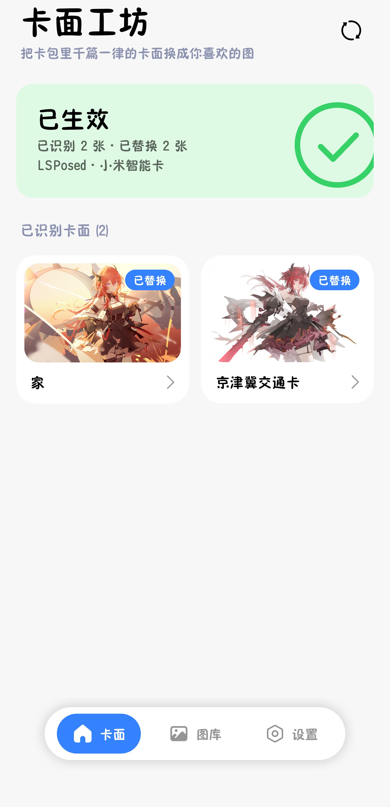
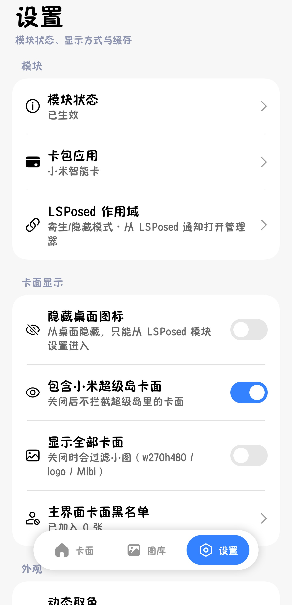
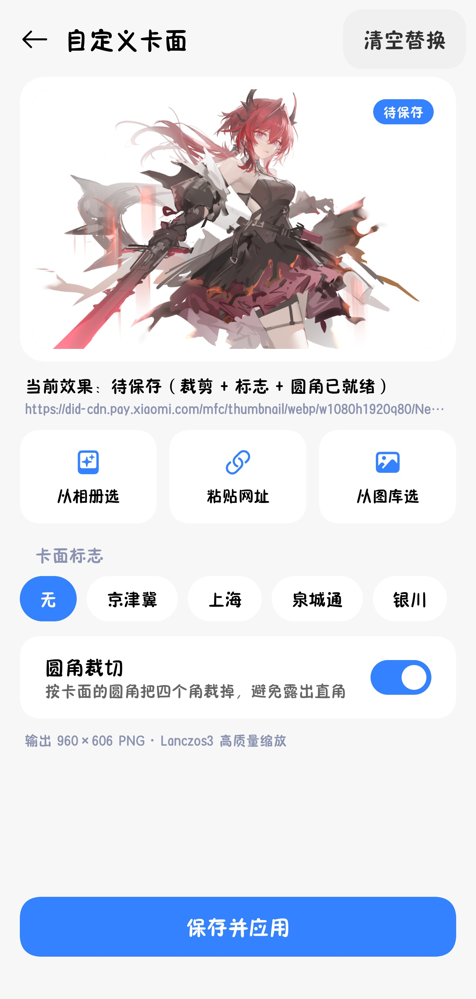
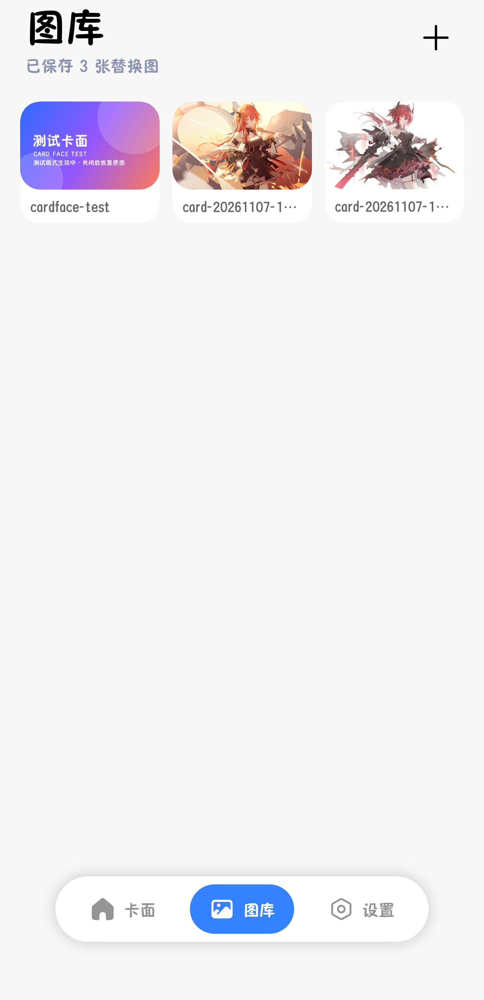
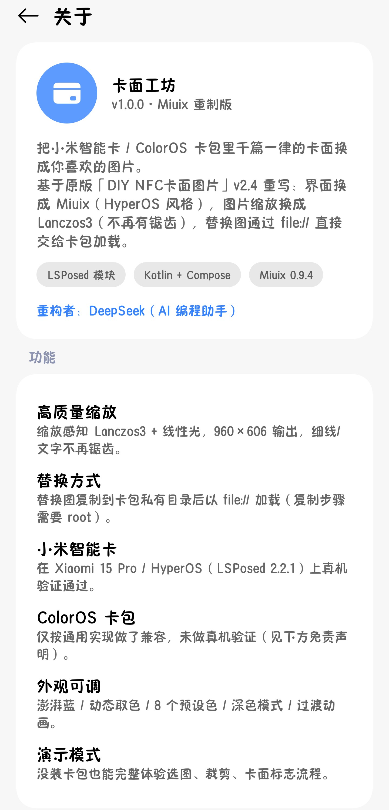

<p align="center">
  
</p>

<h1 align="center">卡面工坊</h1>

<p align="center">
  把小米智能卡 / ColorOS 卡包里千篇一律的卡面，换成你自己喜欢的图片<br/>
  <sub>LSPosed 模块 · Miuix（HyperOS）界面 · Lanczos3 图像管线</sub>
</p>

<p align="center">
  <a href="LICENSE"></a>
  
  
</p>

---

## 截图

| 首页 | 设置 |
|---|---|
|  |  |

| 编辑卡面 | 图库 |
|---|---|
|  |  |

| 关于 |
|---|
|  |

## 功能

- **替换卡面**：把图片合成为 960×606 PNG，复制到卡包私有目录后以 `file://` 交给卡包加载；
  兼容卡包 Glide 加载链路（反编译定位 `CustomGlideUrl` 工厂方法与 `RequestManager` 重载）。
- **高质量缩放**：缩放感知 Lanczos3 + sRGB 线性光重采样，细线 / 文字不再有锯齿（原版为最近邻缩放）。
- **图库 / 裁剪 / 卡面标志**：3 列图库、160:101 固定比例裁剪（双指缩放、拖动、缩放按钮）、
  京津冀 / 上海 / 泉城通 / 银川 标志、圆角裁切。
- **Miuix（HyperOS）界面**：SukiSU 风格状态卡、灰底白卡分组、澎湃蓝 / 动态取色 / 8 个预设色 /
  深色模式 / 过渡动画、底部悬浮导航。
- **其他**：卡面重命名、隐藏桌面图标（带通知入口防丢）、hook 缓存清理、一键重启卡包。

## 环境要求

- Android 8.0+（minSdk 26，targetSdk 36）
- 已 root，并安装 **LSPosed**（libxposed API 101+）
- 卡包：小米智能卡（`com.miui.tsmclient`）已验证；ColorOS 卡包（`com.finshell.wallet`）未做真机验证，见下方免责声明
- 参考验证环境：Xiaomi 15 Pro / HyperOS 4 / LSPosed 2.2.1 + 小米智能卡

## 安装与使用

1. 安装 Release 里的 `CardFace-v1.0.0.apk`。
2. 在 LSPosed 里启用「卡面工坊」，作用域勾选：小米智能卡 / ColorOS 卡包。
3. 打开卡包，把卡面浏览一遍（让 hook 记录到卡面地址）。
4. 回到「卡面工坊」→ 点一张卡面 → 从相册选图 / 从图库选 → 裁剪 / 加标志 → 保存并应用。
5. 重启卡包（保存成功后可一键重启），卡面即生效。

> **隐藏 / 寄生模式的 LSPosed**：部分设备的管理器没有桌面图标，也无法被第三方 App 直接打开
> （LSPosed 用进程内随机 UUID 广播拉起管理器）。此时从通知栏的「Xposed 模块已更新 / LSPosed」通知进入管理器，
> 长按模块 →「模块设置」即可打开本应用。App 里点「打开 LSPosed」也会给出这个提示。

## 构建

需要：JDK 17、Android SDK Platform 37、Build Tools 37.0.0。

```bash
# 1. 准备签名（可选：不配也能 build，release 产物为未签名 APK）
cp keystore.properties.example keystore.properties
# 把自己的 keystore 放到 keystore/ 下，并改 keystore.properties

# 2. 构建
./gradlew :app:assembleRelease
# 产物：app/build/outputs/apk/release/app-release.apk
```

仓库不包含签名文件与 `keystore.properties`（已在 `.gitignore` 中）。

## 项目结构

```
app/       Android 应用（Compose + Miuix），含 Xposed 模块入口
imaging/   纯 JVM 图像管线（Lanczos3 降采样、缩放、合成），可单测
docs/      规格、进度记录、截图
```

## 免责声明与兼容性

- **ColorOS 卡包**：未做真机验证，仅按通用包名 / 加载逻辑兼容，可能识别不到卡面、替换不生效或显示异常，请自行评估风险。
- **小米智能卡**：在上述参考环境验证通过，其他机型 / 系统 / 卡包版本可能存在差异。
- 替换图片需要把图复制进卡包私有目录（`file://`），**复制步骤需要 root**；没有 root 时会退回 `content://`，
  但部分卡包版本不认。
- 本应用只修改卡包展示图，不涉及支付、余额与刷卡逻辑；因使用本应用产生的任何问题由使用者自行承担。
- 请勿用于伪造证件、支付欺诈等任何违法用途。

## 许可证

[GPL-3.0](LICENSE)。本项目包含 / 链接了以下开源项目：

- 原版项目：[DIY NFC卡面图片](https://github.com/zhizi42/DIY_NFC_CardFace) v2.4（zhizi42，GPL-3.0）
- UI 组件：[Miuix](https://github.com/miuix-kotlin-multiplatform/miuix)（Yukonga，Apache-2.0）
- 模块框架：[LSPosed](https://github.com/LSPosed/LSPosed)（GPL-3.0）、[libxposed API](https://github.com/LibXposed/libxposed-api)（Apache-2.0）
- Dex 定位：[DexKit](https://github.com/LuckyPray/DexKit)（LuckyPray，Apache-2.0）
- AndroidX / Jetpack Compose / Coil 3（Apache-2.0）

## 致谢

- **作者**：MiamBao
- **重构与实现**：DeepSeek（AI 编程助手）—— Miuix 界面重构、卡面 hook 链路、图像管线与性能优化
- 以及原版作者 zhizi42 与上述开源项目的作者们
